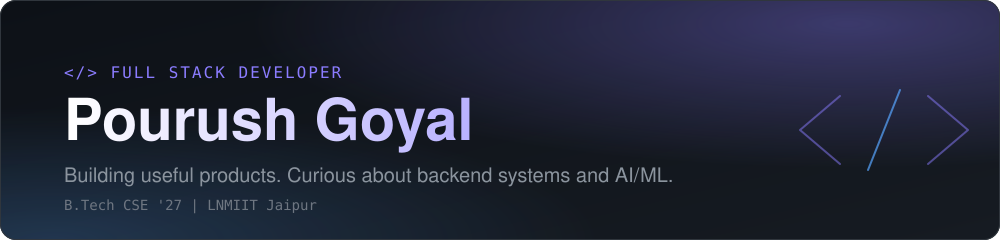

&#x20;\

\

\

\ 

## About

I'm a **B.Tech Computer Science student at LNMIIT Jaipur (Class of 2027)** who enjoys turning ideas into products people can actually use.

I work across the stack, from React interfaces to Node.js APIs and MongoDB, and I'm increasingly drawn to **backend engineering** and **applied AI/ML**. I've solved **500+ DSA problems** across LeetCode and GeeksforGeeks, and I like pairing that problem-solving discipline with real, shippable projects.

> Aspiring Software Engineer, focused on full stack development and building products that solve real problems.

\ 

## Tech Stack

\<table>   \<tr>     \<td>\<b>Languages\</b>\</td>     \<td>C • C++ • Python • Java • JavaScript\</td>   \</tr>   \<tr>     \<td>\<b>Frontend\</b>\</td>     \<td>React.js • HTML5 • CSS3 • Tailwind CSS\</td>   \</tr>   \<tr>     \<td>\<b>Backend\</b>\</td>     \<td>Node.js • Express.js • REST APIs\</td>   \</tr>   \<tr>     \<td>\<b>Database\</b>\</td>     \<td>MongoDB\</td>   \</tr>   \<tr>     \<td>\<b>AI / ML\</b>\</td>     \<td>NumPy • Pandas • Matplotlib • Scikit-learn\</td>   \</tr>   \<tr>     \<td>\<b>Tools\</b>\</td>     \<td>Git • GitHub • Docker • Postman • VS Code • Google Colab\</td>   \</tr>   \<tr>     \<td>\<b>AI Tools\</b>\</td>     \<td>ChatGPT • Claude • GitHub Copilot • Cursor\</td>   \</tr> \</table>

\ 

## Featured Projects

\<table>   \<tr>     \<td width="50%" valign="top">       \<h3>\<a href="[https://github.com/beingpourush/DocVerse](https://github.com/beingpourush/DocVerse)">DocVerse\</a>\</h3>       \
A full stack doctor appointment platform with separate \<b>user, doctor, and admin dashboards\</b>. Includes JWT-based role authentication, appointment scheduling, REST APIs, and Razorpay payments.\
       \
\MongoDB · Express.js · React.js · Node.js · Razorpay\\
     \</td>     \<td width="50%" valign="top">       \<h3>\<a href="[https://github.com/beingpourush/BgDrop](https://github.com/beingpourush/BgDrop)">BgDrop\</a>\</h3>       \
An AI-powered \<b>background removal\</b> web app. Users sign in with Clerk, process images through the Clipdrop API, and buy credits via a Razorpay payment flow.\
       \
\MongoDB · Express.js · React.js · Node.js · Clerk\\
     \</td>   \</tr>   \<tr>     \<td width="50%" valign="top">       \<h3>PhishGuard ML\</h3>       \
Machine learning-based \<b>phishing detection\</b> trained on 11,000+ samples and 30 features. Compared Random Forest, Decision Tree, MLP, and Logistic Regression, reaching \<b>97.42% peak accuracy\</b>.\
       \
\Python · Scikit-learn · Pandas · NumPy\\
     \</td>     \<td width="50%" valign="top">       \<h3>Faculty Onboarding Portal\</h3>       \
Contributed to a portal built for \<b>LNMIIT\</b>, designed around the institute's workflow to make faculty application tracking more organized.\
       \
\Institute Project · LNMIIT\\
     \</td>   \</tr> \</table>

\
\<a href="[https://github.com/beingpourush?tab=repositories](https://github.com/beingpourush?tab=repositories)">All repositories &rarr;\</a>\

\ 

## Let's Connect

Always happy to talk about software engineering, full stack projects, and AI/ML. Reach out on any of these.

\

\<a href="[https://www.linkedin.com/in/pourushgoyal/](https://www.linkedin.com/in/pourushgoyal/)">\\</a>
\<a href="mailto\:pourushgoyal2005\@gmail.com">\\</a>

\ \ 

\Built with curiosity, refined with every commit.\

\

